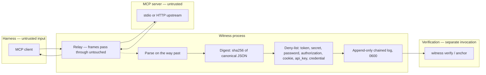

# Threat model and trust boundaries

Scope: the Witness recorder — the stdio and HTTP proxies, the per-session log, and the CLI that verifies and reads it. The feed relay has its own section at the end.

## Protected assets

- the ordered record of tool calls and outcomes per session
- the integrity of each session's chain and of the checkpoint chain
- the declared principal and client identity attached to each call
- the confidentiality of everything Witness deliberately does not store: arguments, results, headers, environment

## Adversaries and failure modes

- **A compromised or malfunctioning agent** may issue calls it should not, omit calls, or flood the relay. Witness records what crossed the boundary; it cannot see calls that bypass the wrapped server.
- **A malicious or broken MCP server** may answer late, never, out of order, with non-JSON, or with adversarial text in results. Every case is a recorded outcome (`error`, `unknown`, `raw`), never a dropped frame.
- **A local user with write access to `WITNESS_HOME`** may edit, truncate, reorder, or delete records after the fact.
- **A user who controls the harness config** may unwrap a server, point a config at an unrecorded copy, or run the server directly.
- **The recorder itself** may fail to write (disk full, permissions, crash).

## Trust-boundary diagram

## Controls in this version

- **Relay before record.** The frame is forwarded before it is parsed. A parse or write failure is written to stderr and the relay continues.
- **Digest, not store.** `args_sha256` and `result_sha256` are the SHA-256 of canonical JSON. Plaintext appears only in `args_summary`, only for keys the operator allow-lists, never for keys matching the deny-list, truncated to 120 characters.
- **Headers are never recorded.** The HTTP proxy forwards `Authorization` and every other header unchanged and records none of them.
- **Every record carries `prev` and `hash`.** `hash = sha256(canonical(record) + prev)`. Editing any record breaks verification at that record; deleting a record breaks it at the next; truncating the tail is detectable only by comparing the head against a checkpoint or anchor.
- **Unanswered is `unknown`.** A call the server never answered is sealed as `unknown` at session end, never as `ok` and never omitted.
- **Files are `0600`, the directory `0700`.**
- **The command line is digested.** `server.cmd_sha256` in `session_start` makes a substituted binary visible across sessions.
- **Verification is a separate process** with no shared state with the recorder beyond the files.

## Residual risk

- An administrator with filesystem access can rewrite a log and rewrite the verifier. A chain proves internal consistency, not provenance. `anchor --git` gives a third-party clock only to the extent the git repository is one. A countersigned head (v0.4, below) gives a clock held by another party, for the records up to the sealed `seq`.
- The principal is declared (`verified: false`). Nothing in this version binds a record to a person or a device.
- Only wrapped servers are observed. Witness cannot enumerate what was not wrapped, and says so.
- Timing side channels: `ms` and `args_bytes` / `result_bytes` are recorded and can reveal something about the content they digest. Operators handling sensitive tools should treat the log as confidential.
- A server that writes JSON-RPC across multiple lines, or a client that does, is recorded as `raw` and not classified.

## The feed relay

Scope: `witness keygen`, `witness feed publish`, `witness feed serve` and `witness feed pull`, the signed relay of refusal indicators between Witness homes ([SPEC-0.2.md](../SPEC-0.2.md) section 5). The council gate that reads the feed belongs to the council mod, not to this package.

### Protected assets

- the integrity of each peer's published chain and of every remote copy of it
- the rule that only records signed by a trusted peer key enter a remote copy
- the private key in `keys/<key_id>.key`

### Trusted keys

- A peer is trusted only when its `.pub` is in `keys/`. The operator copies it there. Pull never fetches a key, and it never trusts a key because a reply names it.
- `key_id` is a name, not a trust anchor. It holds 32 bits of the key digest, so an attacker can make a different key with the same `key_id`. Pull checks every signature with the content of `keys/<key_id>.pub`, and that file must hash to its `key_id`. Compare the whole `.pub` content, not only the `key_id`, when you accept a peer key.
- `keys/` is 0700 and its files are 0600.

### Adversaries and controls

- **A server that lies**, or anything on the network path, because the feed is plain HTTP. It can edit, forge, reorder, insert or drop lines. Every line must carry a valid signature from the trusted key of that peer, its hash must recompute with `signer` removed, and its `seq` and `prev` must continue the local copy. Pull stops at the first bad line, keeps the lines before it, appends nothing after it, and exits 3. One reply holds one `key_id`, and `feed/remote/peers.json` binds each URL to its key, so a server cannot switch a URL to another trusted key.
- **Replay and gaps.** A replayed line has a `seq` that does not continue the copy. A dropped line leaves a gap in `seq`. A reordered line breaks `prev`. Each case stops the pull with exit 3.
- **A peer that rewrites its own history** and signs it again from an earlier `seq`. Its next new line does not continue the copy by `prev`, so pull exits 3. The puller keeps the original lines.
- **An edit to a line that the puller already holds.** Pull asks only for the lines after its last `seq`, so it does not see that edit. Its copy keeps the signed original. `witness verify` on the publisher finds the edit.
- **A peer key compromise.** Whoever holds a peer's `.key` can sign any feed record as that peer. Every home that trusts the peer then refuses calls whose indicator digest matches. A forged entry can cause a refusal, not a run: the gate only adds a refusing vote. To recover, delete the peer's `.pub` from `keys/`, delete `feed/remote/<key_id>.jsonl`, and remove the URL from `feed/remote/peers.json`. There is no revocation list and no key rotation.
- **A local key compromise.** Whoever reads `keys/<key_id>.key` can sign as this home. The file is 0600, and Witness never sends it anywhere.
- **A server that floods.** Pull reads at most 32 MiB and waits at most 30 seconds. Then it exits 1 and appends nothing.
- **A client that probes the server.** The server answers only `GET /feed`. Every other path gives 404 and every other method on `/feed` gives 405. It has no write endpoint and reads only `feed/published.jsonl`. It binds only to `--host`, default `127.0.0.1`. An empty `--host` (for example an unset shell variable) is refused, because Node would bind it to every interface. A host that resolves to every interface needs `--any-interface` as well.
- **A local user who swaps `published.jsonl` for a link**, for example a symbolic link or a hard link to `keys/<key_id>.key`. The server opens the file with `O_NOFOLLOW` and `O_NONBLOCK`, and it serves only a regular file with one hard link. A link, a directory or a FIFO gives 500 and no file bytes.
- **A client that exhausts the server.** The server streams each reply with backpressure and never reads the whole file into memory. A reply holds at most 32 MiB of whole lines. At most 8 replies run at once, and a ninth request gets 503. A socket with no traffic for 30 seconds is destroyed, and a request must arrive in 30 seconds. When a client leaves during the scan for `?after=`, the scan stops at its next 64 KiB chunk. A slot stays taken until its scan, its stream and its file handle are all done, so clients that leave cannot pile up scans or open files.
- **A new URL that names a copied key.** Pull sends one request for the whole feed. The lines that overlap the local copy must be byte-identical to it, and every new line must verify and continue the chain. Any difference stops the pull with exit 3 and appends nothing after it.
- **A reply that trips the checker.** A last line with no newline fails. An exception while a line is checked, for example a record nested too deep to hash, fails that line. Both keep the lines before it and exit 3.
- **A forged or broken feed file on disk.** `witness feed match` counts a hit only from a file that verifies: a valid chain, signed by a trusted key where the file needs a signer, and for a remote copy signed by the key in its file name. A file that does not verify, or cannot be read, gives exit 2. A `*.jsonl` name in `feed/remote/` must be exactly `<key_id>.jsonl`, so a name such as `.jsonl` cannot switch off the key check. A blank line is a bad line in every feed file.
- **A broken binding file.** A `feed/remote/peers.json` that cannot be read or holds bad data stops pull with exit 1 before its request. A broken binding file therefore cannot let a URL switch to another key. The append and the binding of one pull run under one exclusive lock, `feed/remote/peers.json.lock`, and pull reads the bindings again under it. Two pulls at once therefore keep both bindings, and a URL that another pull bound to a different key meanwhile is a conflict: exit 3, nothing changed.
- **A broken or stripped local chain.** publish verifies `feed/refusals.jsonl` and `feed/published.jsonl` first. If either is broken, it publishes nothing and exits 3. The hash does not cover `signer`, so a signed chain requires a signer on every record, and a stripped signer fails.

### Residual risk

- A server can withhold new records. A puller cannot tell a quiet peer from a server that hides records.
- The feed has no TLS and no authentication. Anyone on the network path can read it. Bind to loopback, or carry the feed over SSH or a VPN.
- The gate does not verify signatures again. A local user who can write `feed/remote/` can add entries. That user can also write `keys/`, so this is the local-user risk above, and a forged entry causes refusals only.
- An indicator digest of a short or common value, such as a domain or a tool name, can be reversed by guessing.
- `O_NOFOLLOW` checks only the last part of the path. A link at `feed/` or above is followed. Making such a link needs write access to `WITNESS_HOME`, which is the local-user risk above.

## Countersigned heads

Scope: `witness seal`, `witness notary serve`, `witness notary verify`, `witness countersign` and `witness check` ([SPEC-0.4.md](../SPEC-0.4.md)).

### What a passing check proves

`witness check <session> --notary <fingerprint>` exits 0 when all of these hold: the session chain is intact; the record at each head's `seq` has the head's `hash`; each head is signed by the key it carries (and by the `--operator` key, when given); and a receipt signed by the notary key names that head. Receipts from other notary keys are skipped with a NOTE, so a session countersigned with two notaries checks under either one; a receipt that names the `--notary` key_id is always checked, so a forged one fails (exit 5). Every head that another notary receipted must also have a receipt from the `--notary` key (exit 7). Together: a chain whose record at `seq` had this `hash` existed no later than the receipt's `ts`, by the notary's clock, and the files checked still hold that chain up to `seq`.

It proves this against one adversary: **an operator or administrator who controls the operator's machine but not the notary or the notary key**, and only when the checker does not depend on that adversary for the receipts. The checker must hold a receipt it got independently (kept from an earlier check, or fetched from the notary), or run check with `--notary-log` on a copy of the notary log it got from the notary. Then that adversary cannot edit, insert, delete or reorder a record at or before the sealed `seq` without check failing: a plain edit breaks the chain (exit 2), a chain rebuilt after an edit no longer has the sealed hash at the sealed `seq` (exit 3), a forged or replaced head fails its signature (exit 4), and the receipt still names the original head (exit 6, or exit 8 with `--notary-log`). With only the files the operator hands over, a log that the operator rewrote, sealed and countersigned again passes check (exit 0); see the first bullet below. Replacing the verifier on the operator's machine does not help, because check runs on the outside party's machine with its own copy of the code, or with any implementation of SPEC-0.4.

### Adversaries and controls

- **An operator who rewrites and countersigns again.** The operator can seal a rewritten chain and get a fresh receipt. Check against only the rewritten files then passes. The new receipt has a later notary `ts` and a higher notary `seq`, and the notary log still holds the receipt for the original head. The rewrite shows when the outside party holds an earlier receipt, or runs `check --notary-log` with a copy of the notary log from the notary: the receipt for the original head names a head that is not presented (exit 8).
- **An operator who deletes receipts or heads.** Check exits 7. The notary log still holds every receipt it issued.
- **An operator key compromise.** Whoever holds the operator `.key` can sign any head. A receipt still fixes when each head reached the notary, so a stolen key cannot backdate a head. Without `--operator`, check takes the key from the head; with `--operator <fingerprint>`, a head signed by another key fails (exit 4).
- **A notary that colludes with the operator, or a notary key compromise.** Receipts can then be issued at any time with any `ts`. Check cannot tell. The receipt is worth exactly the independence of the notary and the safety of its key.
- **A notary that shows different logs to different parties.** There is no public transparency log. A party that holds only its own receipts cannot see a split view.
- **The network path.** Countersign uses plain HTTP unless the URL is `https://`. A party on the path can drop, delay or answer for the notary. It cannot forge a receipt that passes: countersign checks the receipt names the sent head and its hash recomputes, and with the notary `.pub` in `keys/` it checks the signature and stores nothing on a failure (exit 3). Without the `.pub`, countersign stores the receipt and reports it unverified; check verifies it later against the notary key.
- **A client that floods or probes the notary.** The notary answers only `POST /receipt`: 404 on other paths, 405 on other methods. It binds only to `--host`, default `127.0.0.1`, with the host rules of `feed serve`. A body over 64 KiB gets 413, and a declared length over the cap is refused before the body is read. At most 8 requests run at once; another gets 503. A socket with no traffic for 30 seconds is destroyed. Every `POST /receipt`, from all clients together, takes a token from one bucket that holds `--rate` tokens (default 10) and refills at `--rate` per second; a request with no token gets 429 with `Retry-After: 1`, before its body is read. The bucket is one for all clients, so one client can empty it and every client then gets 429; this is an accepted limit for a notary bound to loopback or a trusted network. The log therefore grows by at most about 10 receipts (about 6 KB) per second at the default, and a client that floods it slows every other client, which is the cost of one global cap. Each append checks the tail by reading only the last line, so the cost of an append does not grow with the log. The notary stores only the digest and four fields of each head, never the head itself.
- **A broken or edited notary log.** `notary serve` verifies the whole log at start and refuses to serve a broken one (exit 3). Before each append it compares the last line on disk with the last line it wrote, and verifies the whole log again when they differ. A log that no longer verifies stops every later receipt (500). `notary verify` walks the chain: every record signed by one trusted key, `seq` equal to the position, a stripped signer is a failure.
- **A forged head sent to the notary.** The notary checks the signature and that `key_id` matches the included public key (422 otherwise). It does not check that the key belongs to anyone: it attests receipt time, not identity.

### Residual risk

- Records after the last countersigned head are covered by nothing. A tail truncated back to the sealed `seq` is not detected.
- `ts` in a receipt is the notary's clock. There is no timestamp authority.
- `key_id` holds 32 bits of the key digest, so a key with the same `key_id` can be made with about 2^32 tries. `check --notary` and `--operator`, and `countersign --notary`, take the full 64-hex fingerprint and then accept only that key. Given only a `key_id`, they accept any `.pub` with that prefix and print a warning with the fingerprint to pin. Get the fingerprint from the notary or operator over a channel you trust, not from the files you check.
- There is no key revocation or rotation for operator or notary keys.
- A receipt says nothing about whether a record is true, or about calls that never crossed a wrapped server.
